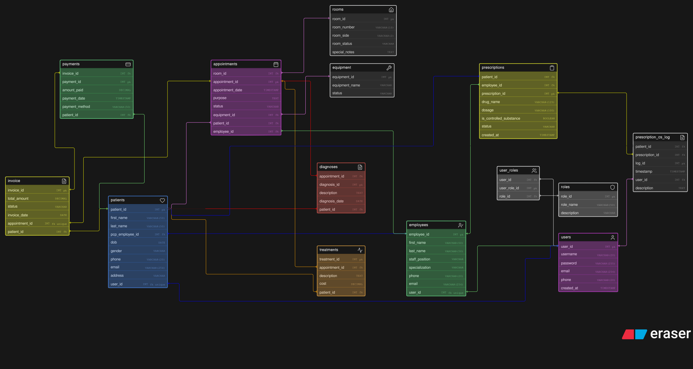

# Welcome to the ERD Diagram README 

  

Part I required us to create an ERD Diagram of a hospital database. We were instructed to ensure that we have all the required entities, attributes with data types, and all relationships with quantifiers. 

**Directory Navigation Links:**
- [erd.d2](erd.d2) - This document is the official export of my d2 commands straight from Visual Studio Code. Here is where you will find my comments and outline for my tables.
- [erd.svg](erd.svg) - This is the SVG image of my database map. (This options prompts a download)
- [erd.pdf](erd.pdf) - This is an identical image to the SVG map, instead as a PDF if SVG images aren't accessible.

**Other directories:**
- [Primary README](../README.md)
- [SQL Server Directory](../sqlserver/README.md)
